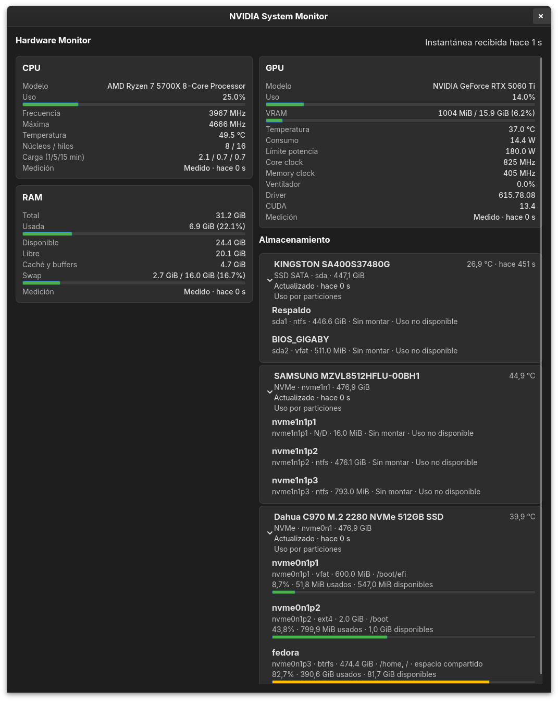

# NVIDIA System Monitor for LINUX



Monitor de escritorio GTK4 para Linux (desarrollado y probado en Fedora): GPU NVIDIA, CPU, RAM y almacenamiento, con sensores opcionales.

Este README describe el código de esta rama. El canal selecciona identidad y rutas;
no cambia de versión ni integra esta rama en `main`. A1, A2, A3, A6 y A7 están
resueltos. Esta corrección completa el instalador por usuario de A4; A5 sigue
parcialmente pendiente antes de preparar una publicación estable. No se crea una
versión ni una etiqueta Git con este cambio.

## Qué monitoriza

**GPU NVIDIA** (vía `nvidia-smi`; soporta varias GPU): modelo, uso, VRAM, temperatura,
consumo y límite de potencia, frecuencias de núcleo y memoria, ventilador, versión del
driver y de CUDA. Si NVIDIA o el driver no están disponibles, el panel lo indica.

**CPU**: modelo, uso, frecuencia actual y máxima, núcleos/hilos, carga 1/5/15 min y
temperatura cuando existe `k10temp`, `zenpower` (AMD) o `coretemp` (Intel).

**RAM**: total, usada, disponible, libre, caché y buffers, swap.

**Almacenamiento**: cada disco físico con modelo, tipo (NVMe, SSD SATA, HDD, USB, eMMC/SD),
capacidad y temperatura; debajo, sus particiones y volúmenes anidados (LUKS, LVM) con
sistema de archivos, punto(s) de montaje y uso. Si un dispositivo tiene varios montajes
(p. ej. subvolúmenes btrfs en `/` y `/home`), el uso mostrado es el del sistema de
archivos completo.

**Sensores** (opcional, desactivado por defecto): lecturas de temperatura de `lm_sensors`,
útiles para ver la placa base. Se activa con `"sensors": true` en `panels`.

Los datos ausentes se muestran como `N/D`; nunca se sustituyen por valores inventados.

## Instalación

Requisitos: Linux, Python **3.10 o posterior**, PyGObject y GTK **4.6 o posterior**.
Se utiliza [`Gtk.FlowBox.append`, disponible desde GTK 4.6](https://docs.gtk.org/gtk4/method.FlowBox.append.html).
El namespace de introspección sigue siendo `Gtk` versión `4.0`; esto no significa
que cualquier versión menor de GTK 4 sea suficiente. La carga de CSS conserva una
alternativa para GTK anterior a 4.12. `lsblk` (util-linux) es necesario para detectar
la topología del almacenamiento. La aplicación requiere una sesión gráfica para
mostrar la interfaz.

### Fedora

```bash
sudo dnf install python3 gtk4 python3-gobject util-linux
```

### Otras distribuciones

- **Ubuntu / Debian** (compruebe que la versión de la distribución proporciona GTK ≥ 4.6):

```bash
sudo apt install python3 python3-gi gir1.2-gtk-4.0 util-linux
```

- **Arch Linux / Manjaro** (sin probar):

```bash
sudo pacman -S python gtk4 python-gobject util-linux
```

No se necesitan paquetes adicionales mediante `pip` ni libadwaita; PyGObject y
las bibliotecas de introspección se instalan con los paquetes del sistema.

### Opcionales

```bash
sudo dnf install lm_sensors        # panel de sensores
sudo dnf install udisks2           # temperaturas SMART almacenadas, si están disponibles
sudo dnf install smartmontools     # alternativa smartctl; necesita permisos sobre el dispositivo
```

`nvidia-smi`, proporcionado por el driver NVIDIA, es opcional para el resto de
paneles. Gio viene con PyGObject y permite consultar UDisks2 por D-Bus; no se
requiere un binding D-Bus adicional. Instalar UDisks2 no garantiza temperaturas:
el servicio debe estar disponible y exponer SMART habilitado y una medición válida
para ese disco. La aplicación no inicia el servicio ni pide autenticación.

**Otra fuente SATA sin ejecutar la aplicación como root:** el módulo `drivetemp`
del kernel, cuando el hardware lo admite. Su carga requiere administración:

```bash
sudo modprobe drivetemp                                         # hasta el próximo reinicio
echo drivetemp | sudo tee /etc/modules-load.d/drivetemp.conf    # permanente
```

## Ejecución

Desde la raíz del repositorio:

```bash
python3 bin/system_monitor.py --channel dev
python3 bin/system_monitor.py --channel stable
python3 bin/system_monitor.py                 # stable, por compatibilidad histórica
```

También se admite `--channel=dev`. El canal se valida antes de importar GTK;
un valor inválido o repetido produce un error. Los demás argumentos se entregan
a GTK sin cambios; `--` termina el procesamiento de opciones propias. No se
deduce el canal de la rama Git, la ubicación del repositorio ni el usuario.

Los canales usan IDs GTK diferentes y pueden ejecutarse simultáneamente. Una
segunda instancia del mismo canal activa la existente. El canal `stable` conserva
la identidad de las instalaciones anteriores, por lo que puede activar una
instancia estable ya abierta: use `--channel dev` para trabajar en esta rama.

El instalador fuente añade al menú un launcher y un icono independientes por canal,
y copia la configuración de ejemplo solo si no existe. No ejecuta `sudo` ni escribe
recursos globales. Los comandos siguientes se muestran desde la raíz del repositorio:

```bash
./install.sh --channel dev
./install.sh --channel dev --check-launcher     # comprobar sin escribir
./install.sh --channel dev --uninstall
./install.sh --channel stable
./install.sh --uninstall                       # stable por defecto
```

Estos comandos modifican la instalación si se ejecutan. El launcher DEV es
`cl.mastro.NvidiaSystemMonitor.Dev.desktop`; el estable conserva
`cl.mastro.NvidiaSystemMonitor.desktop`. Las plantillas nuevas indican su canal explícitamente.
DEV no reemplaza el launcher, configuración ni icono de estable. Ambos canales
conservan el mismo diseño gráfico, con archivos instalados distintos:

| Recurso | `stable` | `dev` |
|---|---|---|
| Launcher en `applications/` | `cl.mastro.NvidiaSystemMonitor.desktop` | `cl.mastro.NvidiaSystemMonitor.Dev.desktop` |
| PNG en `icons/hicolor/scalable/apps/` | `cl.mastro.NvidiaSystemMonitor.png` | `cl.mastro.NvidiaSystemMonitor.Dev.png` |

Estas rutas se encuentran bajo `XDG_DATA_HOME`, o `~/.local/share` si la variable
está vacía o no es absoluta. El PNG existente del repositorio se copia sin alterar
su diseño. GTK encuentra ambos iconos mediante el tema `hicolor`, sin necesitar
una actualización global de cachés. El icono histórico de `/usr/share/icons` no se
sobrescribe ni se elimina; el recurso estable del usuario tiene prioridad.

También puede invocar `"/ruta/con espacios/al/repositorio/install.sh" --channel dev`
desde otro directorio. El script ancla la importación del helper a su propio
repositorio, incluso si el directorio actual contiene otro paquete `src`. Se admiten
espacios en la ruta; se rechazan comillas dobles, acentos graves, `$`, `\`, `%` y
saltos de línea por las reglas de `Exec` del launcher.

El launcher ejecuta el código de ese checkout mediante una ruta absoluta; no se
copia el programa a otra ubicación. Mantenga checkouts separados para DEV y estable.
Tras mover un checkout, repita la instalación del canal correspondiente para
actualizar su ruta. Una actualización conserva configuración, alias y registros.

**Migración de launchers DEV anteriores:** los instalados antes de esta separación
pueden carecer de `--channel dev`. Con el nuevo valor predeterminado iniciarían
la identidad estable, aunque el menú diga DEV. Deben regenerarse; modificar el
código o la plantilla no actualiza el launcher ya instalado.

Primero ejecute `./install.sh --channel dev --check-launcher`. Es una comprobación
de solo lectura: devuelve 0 si está compatible o ausente, 3 si detecta un launcher
DEV antiguo y 2 si rechaza una ruta, enlace o contenido inseguro. La regeneración
se solicita después mediante `./install.sh --channel dev`; reemplaza únicamente
el launcher e icono DEV y conserva la configuración existente. El cambio de `Exec` es:

```diff
-Exec=python3 "RUTA_DEL_REPOSITORIO/bin/system_monitor.py"
+Exec=python3 "RUTA_DEL_REPOSITORIO/bin/system_monitor.py" --channel dev
```

La ruta real del repositorio se conserva al regenerar desde ese mismo repositorio.
El launcher estable no necesita migración para mantener su funcionamiento histórico.
La comprobación no instala ni regenera archivos automáticamente.

Para actualizar instalaciones anteriores, vuelva a ejecutar el instalador con el
canal explícito desde el checkout que quiera utilizar. Esto publica el icono por
usuario del canal sin alterar el icono global ni los recursos del otro canal.
No es necesario borrar preferencias ni migrar sus directorios.

La desinstalación elimina únicamente el launcher y el icono por usuario del canal.
No necesita las plantillas, el PNG fuente ni el ejemplo de configuración, aunque
el script y sus módulos Python deben seguir disponibles. Conserva configuración,
alias, registros, el checkout y el icono global histórico. Pueden quedar directorios
vacíos y metadatos de caché del escritorio; no se borran directorios compartidos.

El helper `src/utils/installer.py` valida el canal de la plantilla y del launcher
existente, y obtiene el nombre de destino de la definición central de canales.
Antes de publicar valida todas las fuentes necesarias (plantilla, punto de entrada,
configuración de ejemplo e icono) y todos los destinos seleccionados.
Rechaza enlaces simbólicos (también colgantes), archivos con enlaces duros y
directorios padres enlazados, tanto al instalar como al desinstalar. La instalación
recorre los directorios con `O_NOFOLLOW`, conserva sus descriptores abiertos y
reemplaza el launcher y el icono por archivos temporales del mismo directorio mediante
renombrado atómico. La configuración inicial se publica sin sobrescribir un
archivo que aparezca concurrentemente. La desinstalación usa `unlink` relativo al
descriptor y nunca sigue el enlace final.

La actualización de `update-desktop-database`, si está disponible, espera como
máximo tres segundos; su ausencia, error o timeout no invalida la publicación.
Si una escritura falla, se eliminan sus temporales; pueden quedar archivos
completos ya publicados y directorios creados. Corrija la causa y repita el comando:
la configuración existente se conserva. No hay rollback conjunto de los recursos.

Esto evita escribir a través de enlaces y redirigir operaciones mediante una
sustitución de directorios padres. Si un directorio abierto se renombra durante
la operación, esta puede afectar al directorio original, ahora movido; puede ser
necesario repetir la instalación cuando la ruta vuelva a estar estable. No es una
barrera de seguridad frente a procesos maliciosos con los mismos permisos, ni una
transacción conjunta entre configuración, launcher, caché e icono. Los directorios
XDG que usan enlaces legítimos deben cambiarse por rutas físicas para instalar.

## Configuración

Las rutas son explícitas por canal:

| Recurso | `stable` (predeterminado) | `dev` |
|---|---|---|
| ID GTK | `cl.mastro.NvidiaSystemMonitor` | `cl.mastro.NvidiaSystemMonitor.Dev` |
| Título | NVIDIA System Monitor | NVIDIA System Monitor DEV |
| Configuración | `~/.config/nvidia-system-monitor/config.json` | `~/.config/nvidia-system-monitor-dev/config.json` |
| Estado | `~/.local/state/nvidia-system-monitor/` | `~/.local/state/nvidia-system-monitor-dev/` |
| Registro | `monitor.log` en el estado estable | `monitor.log` en el estado DEV |

Se respetan `XDG_CONFIG_HOME` y `XDG_STATE_HOME` si contienen rutas absolutas;
los valores vacíos o relativos usan las alternativas de la tabla. No se migran
ni copian preferencias o registros entre canales. Antes de esta separación, DEV
compartía el registro estable; ese archivo existente se conserva tal cual.

Hay un ejemplo completo en `config.json.example`. Todos los campos son opcionales; los
valores inválidos se ignoran y se usa el valor por defecto.

El código lee `storage-aliases.json` en el directorio de configuración del canal y
resuelve identidades mediante enlaces existentes de discos completos en
`/dev/disk/by-id`, dando preferencia a WWN. No existe una interfaz para editar
alias; los nombres configurados tampoco sustituyen los títulos. Las tarjetas
siempre muestran el modelo detectado o el nombre técnico cuando falta el modelo.
No se guardan identificadores reales de discos en el repositorio. Las
particiones se despliegan por disco y conservan su estado durante las actualizaciones.
Los diagnósticos completos están en tooltips; las fuentes obsoletas mantienen su aviso.

En ventanas anchas, CPU y RAM comparten la columna izquierda; GPU y Almacenamiento,
la derecha. `Gtk.FlowBox` reorganiza estas columnas en una sola al reducir el ancho,
sin reconstruir tarjetas ni perder los expanders. La ventana inicia en 1000 × 720,
con un mínimo de 380 × 320; el contenido conserva su altura natural y se desplaza
verticalmente cuando es necesario.

La cabecera indica cuándo se recibió la última instantánea y nombra las fuentes
con avisos. Las temperaturas SMART y UDisks2 muestran su antigüedad en la tarjeta
del disco; una lectura almacenada no hace parecer antiguas las demás métricas.
El tooltip global conserva las edades por fuente y los diagnósticos completos,
con los mismos umbrales de caducidad.

Las etiquetas de volumen se leen mediante `LABEL` en la consulta existente de
`lsblk` y aparecen como título de cada partición. Si no hay etiqueta, el título
es el nombre técnico. El identificador técnico, sistema de archivos, capacidad y
montajes se conservan en la información secundaria; no se infieren nombres
por el formato o el punto de montaje. Esto no modifica las etiquetas reales ni
las reglas de validación de montajes y caducidad.

La barra de cabecera muestra **el uso del sistema de archivos identificado**, no
la ocupación física del disco: porcentaje, espacio usado y espacio disponible
según `statvfs` (porcentaje = usado / (usado + disponible)). Si existen varios
sistemas de archivos independientes, la cabecera indica «Uso por particiones»
y sus barras aparecen al desplegar. Los montajes compartidos de btrfs se muestran
una sola vez, sin sumar subvolúmenes. Sin montaje o medición aparece «Uso no
disponible»; un fallo temporal conserva el último uso con aviso y antigüedad,
mientras que un cambio de identidad del montaje lo invalida inmediatamente.

Para temperatura SATA, el código de esta rama prueba sysfs/drivetemp, después las propiedades
almacenadas de UDisks2 en el bus D-Bus del sistema y, si es necesario, `smartctl`.
Gio forma parte del PyGObject existente; UDisks2 es opcional. No se inicia el
servicio, no se fuerza `SmartUpdate` ni se solicita autenticación. La antigüedad
proviene de `SmartUpdated`, no de la consulta D-Bus, y la misma medición no se
rejuvenece al volver a leerla. La fuente UDisks2 utiliza una cadencia de referencia
de 600 s para calcular su umbral de caducidad (752 s con el timeout predeterminado);
esto no configura ni garantiza la frecuencia de actualización del servicio.
Su antigüedad aparece junto a la temperatura. Se evalúan alternativas si falla
o caduca y se conserva una medición reciente frente a otra más antigua. Los errores
de permisos de `smartctl` permanecen en el diagnóstico y no ocultan una temperatura
válida de otra fuente.

| Clave | Por defecto | Descripción |
|---|---|---|
| `refresh_interval_seconds` | `1.0` | Intervalo de actualización (0.5 – 60). |
| `temperature_unit` | `"C"` | `"C"` o `"F"`. |
| `theme` | `"dark"` | `"dark"` (paleta oscura propia) o `"system"` (usa el tema del sistema). |
| `logging_enabled` | `true` | Escribe el registro en disco. |
| `panels.cpu / gpu / ram / storage` | `true` | Muestra u oculta cada panel. Un panel oculto tampoco se consulta. |
| `panels.sensors` | `false` | Panel de sensores de `lm_sensors`. |
| `color_scheme.low/medium/high_usage_color` | verde / naranja / rojo | Colores de las barras de uso, en formato `#RRGGBB`. |
| `thresholds.medium_percent / high_percent` | `60` / `85` | Porcentajes a partir de los cuales la barra cambia de color. |

Cada canal utiliza un logger y handlers propios, sin propagar mensajes al logger
raíz. Su `monitor.log` es rotativo: 512 KiB más dos archivos de respaldo. Si no
puede abrirse, el registro se desactiva sin impedir el inicio de la aplicación.

## Pruebas

```bash
python3 -B -m unittest discover -s tests -t . -v
```

Las pruebas usan datos simulados (salidas de `nvidia-smi`, `lsblk`, `sensors`, `smartctl`, `/proc`, `/sys`) y no dependen del hardware de la máquina. Requieren PyGObject/Gio
para las pruebas del transporte UDisks2. Las pruebas de interfaz se
omiten automáticamente si no hay GTK o pantalla; la prueba simultánea de canales
también requiere `dbus-run-session`. Para comprobar también el reflujo,
la pantalla virtual debe admitir la ventana de escritorio. Este comando fuerza X11
en sesiones Wayland y usa Cairo para evitar depender de aceleración en Xvfb:

```bash
xvfb-run -a -s '-screen 0 1280x1024x24' \
  env GDK_BACKEND=x11 GSK_RENDERER=cairo python3 -B -m unittest discover -s tests -t . -v
```

En Fedora, las herramientas de pruebas se pueden instalar con:

```bash
sudo dnf install xorg-x11-server-Xvfb xorg-x11-xauth dbus-daemon
```

Se necesitan `xvfb-run`, Xvfb, `xauth` y `dbus-run-session` para ejecutar todas las
pruebas de interfaz y aislamiento. La prueba de canales crea su propio bus de
sesión y directorios XDG temporales. Verifique que el resultado no tenga omisiones
para considerar completa la validación. Esta rama no contiene un workflow de
GitHub Actions; la suite se ejecuta manualmente con los comandos anteriores.

## Diseño técnico

```
bin/system_monitor.py   punto de entrada
src/data/               recolectores (cpu, ram, nvidia, storage, sensors) y collector.py
src/gui/app.py          interfaz GTK4
src/utils/              configuración, registro, rutas XDG y formato
tests/                  pruebas unitarias y de humo de la GUI
```

- Toda la recolección (subprocesos y lecturas de `/proc` y `/sys`) corre en **un único hilo
en segundo plano**. El bucle de GTK solo lee la última instantánea y actualiza los
widgets existentes, por lo que un `nvidia-smi` lento o colgado no congela la ventana.
- Cada fuente falla de forma aislada: si una falla, las demás siguen funcionando y el
encabezado muestra un aviso (el detalle aparece al pasar el cursor).
- La topología de discos (`lsblk`) se consulta cada 15 s; los sensores, cada 5 s.
UDisks2 comparte una consulta entre discos cada 10 s y espera 300 s tras un fallo.
`smartctl -A` se usa como alternativa y almacena una lectura de temperatura durante
10 s por disco; sin lectura espera 300 s antes de reintentar. Una temperatura
extraída con diagnóstico de error conserva ese diagnóstico.
- La edad de una temperatura SMART directa se ancla a su adquisición; la de UDisks2,
a `SmartUpdated`. Volver a consultar una lectura almacenada no reinicia su edad.
El umbral SMART directo es 14,5 s con los parámetros predeterminados; el de UDisks2
es 752 s. Un error genera aviso inmediatamente; al superar el umbral, la tarjeta
deja de mostrar la temperatura y conserva el último valor y edad en el tooltip.
Los 300 s de reintento tras fallo no extienden la validez de la lectura anterior.
- No se ejecutan benchmarks de almacenamiento.

## Limitaciones

- La disponibilidad de temperaturas y consumo depende del hardware, el driver y los
sensores que Linux exponga.
- **No se muestra el consumo eléctrico de la CPU**: no existe una fuente fiable y
universal sin privilegios, y no se presenta una estimación como si fuera una medición.
- La temperatura NVMe se intenta leer de sysfs y, si no está disponible, de
`smartctl`. Para SATA se intenta drivetemp, luego UDisks2 y finalmente `smartctl`.
La disponibilidad depende del hardware, soporte del kernel, propiedades SMART
del servicio y permisos de lectura. La aplicación no eleva privilegios; si no
hay una medición disponible dentro de su umbral de edad, se muestra `N/D`.
- Solo se consulta `nvidia-smi`; no hay soporte para GPU AMD o Intel.
